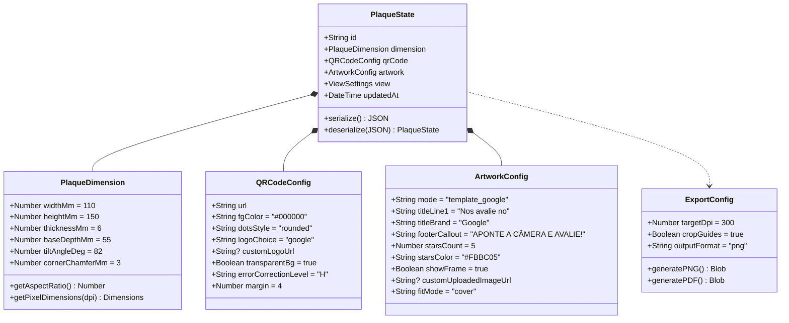

# Data Model: Sistema de Placas Personalizadas com Visualização 3D e Gerador de QR Code

**Feature**: `001-placa-personalizada-3d` | **Date**: 2026-10-05

## Entity Architecture Diagram

---

## Entities Specification

### 1. `PlaqueDimension`
Define os parâmetros físicos da peça de acrílico e proporções da área de colagem.

| Campo | Tipo | Padrão | Validação / Regras | Descrição |
|---|---|---|---|---|
| `widthMm` | Number | `110` | 50 <= x <= 300 | Largura física da placa em milímetros |
| `heightMm` | Number | `150` | 50 <= x <= 400 | Altura física do painel da placa em mm |
| `thicknessMm` | Number | `6` | 2 <= x <= 10 | Espessura da chapa de acrílico |
| `baseDepthMm` | Number | `55` | 30 <= x <= 120 | Profundidade da base de apoio horizontal |
| `tiltAngleDeg` | Number | `82` | 75 <= x <= 90 | Inclinação da placa em relação à base |
| `cornerChamferMm` | Number | `3` | 0 <= x <= 10 | Chanfro suave nos cantos superiores |

### 2. `QRCodeConfig`
Parâmetros de configuração e renderização do QR Code embutido na arte.

| Campo | Tipo | Padrão | Validação / Regras | Descrição |
|---|---|---|---|---|
| `url` | String | `"https://google.com"` | URL válida ou texto | Destino ao escanear o QR Code |
| `fgColor` | String (Hex) | `"#000000"` | Regex `^#([0-9A-Fa-f]{6})$` | Cor dos módulos/pontos do código |
| `dotsStyle` | String Enum | `"rounded"` | `'rounded' \| 'dots' \| 'square'` | Formato visual dos módulos |
| `logoChoice` | String Enum | `"google"` | `'google' \| 'custom' \| 'none'` | Origem do logotipo centralizado |
| `customLogoUrl` | String? (DataURL) | `null` | Imagem válida se `custom` | Imagem de logotipo próprio carregada |
| `transparentBg` | Boolean | `true` | Booleano | Se verdadeiro, remove fundo branco do QR |
| `errorCorrectionLevel`| String Enum | `"H"` | `'M' \| 'Q' \| 'H'` | Nível de redundância para garantir leitura |

### 3. `ArtworkConfig`
Controla a composição 2D estampada sobre o acrílico.

| Campo | Tipo | Padrão | Validação / Regras | Descrição |
|---|---|---|---|---|
| `mode` | String Enum | `"template_google"` | `'template_google' \| 'custom_upload'` | Modo do editor de arte |
| `titleLine1` | String | `"Nos avalie no"` | Max 40 caracteres | Texto introdutório superior |
| `titleBrand` | String | `"Google"` | Max 30 caracteres | Marca ou destaque do título |
| `footerCallout` | String | `"APONTE A CÂMERA E AVALIE!"`| Max 50 caracteres | Frase de rodapé incentivadora |
| `starsCount` | Number | `5` | 1 <= x <= 5 | Quantidade de estrelas decorativas |
| `starsColor` | String (Hex) | `"#FBBC05"` | Cor válida | Cor das estrelas de avaliação |
| `showFrame` | Boolean | `true` | Booleano | Exibir moldura estilizada com cores Google |
| `customUploadedImageUrl` | String? (DataURL) | `null` | Imagem válida se `mode === 'custom_upload'` | Imagem externa completa pronta para impressão |
| `fitMode` | String Enum | `"cover"` | `'cover' \| 'contain'` | Encaixe da imagem enviada na área útil |

### 4. `ExportConfig`
Diretrizes para produção gráfica final.

| Campo | Tipo | Padrão | Descrição |
|---|---|---|---|
| `targetDpi` | Number | `300` | Resolução padrão para gráfica e alta nitidez |
| `pixelWidth` | Number | `1299` | Calculado: `(110 / 25.4) * 300` |
| `pixelHeight` | Number | `1772` | Calculado: `(150 / 25.4) * 300` |
| `cropGuides` | Boolean | `true` | Adicionar linhas suaves de corte na exportação |
