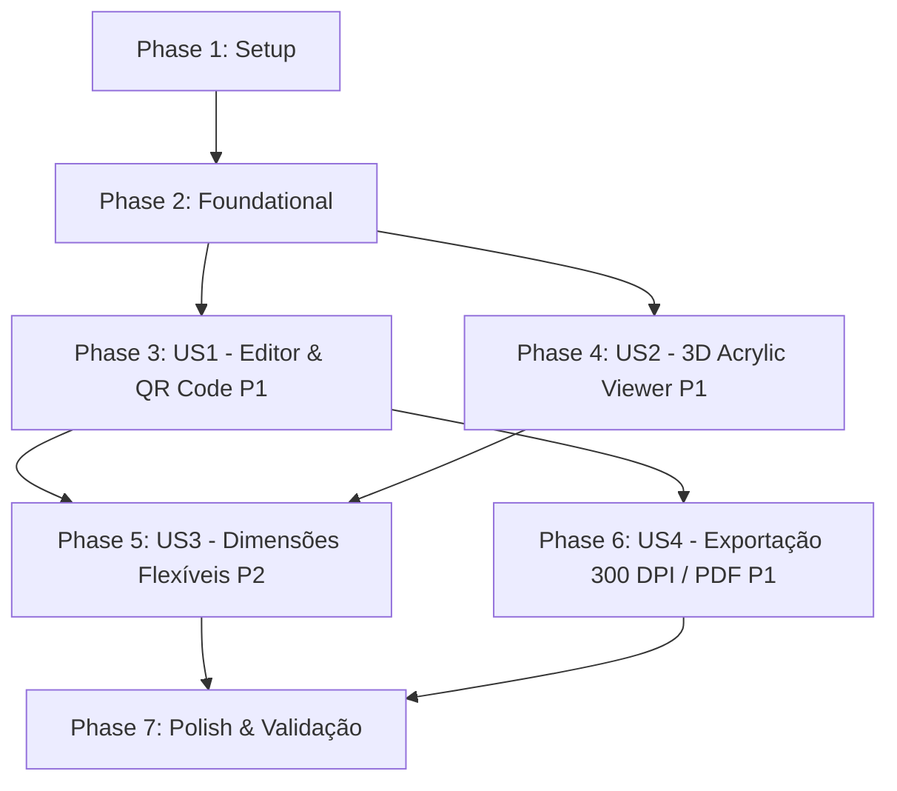

# Tasks: Sistema de Placas Personalizadas com Visualização 3D e Gerador de QR Code

**Feature**: `001-placa-personalizada-3d` | **Branch**: `001-placa-personalizada-3d`

**Input**: Design documents from `specs/001-placa-personalizada-3d/`  
**Prerequisites**: [plan.md](file:///c:/Users/esau0/Downloads/create-plaque/specs/001-placa-personalizada-3d/plan.md), [spec.md](file:///c:/Users/esau0/Downloads/create-plaque/specs/001-placa-personalizada-3d/spec.md), [research.md](file:///c:/Users/esau0/Downloads/create-plaque/specs/001-placa-personalizada-3d/research.md), [data-model.md](file:///c:/Users/esau0/Downloads/create-plaque/specs/001-placa-personalizada-3d/data-model.md), [contracts/editor-contract.md](file:///c:/Users/esau0/Downloads/create-plaque/specs/001-placa-personalizada-3d/contracts/editor-contract.md)

---

## Phase 1: Setup (Shared Infrastructure)

**Purpose**: Inicialização do projeto, estrutura de pastas e dependências principais.

- [x] T001 Criar estrutura de diretórios do projeto em `public/assets/`, `public/models/`, `src/core/`, `src/qr/`, `src/artwork/`, `src/viewer3d/`, `src/export/` e `src/ui/`
- [x] T002 Configurar `package.json` com dependências de produção (`three`, `qr-code-styling`, `jspdf`), dependências de desenvolvimento (`vite`) e scripts de build/dev
- [x] T003 [P] Configurar `vite.config.js` com suporte a módulos ES modernos e servidor local estático
- [x] T004 [P] Copiar `suporte_acrilico-V2.obj` para `public/models/suporte_acrilico-V2.obj` e criar os vetores SVG de logotipo oficial em `public/assets/google-logo.svg` e estrelas em `public/assets/star.svg`

---

## Phase 2: Foundational (Blocking Prerequisites)

**Purpose**: Infraestrutura base, gerenciamento de estado e design system que bloqueiam a implementação das histórias de usuário.

**⚠️ CRITICAL**: Nenhuma história de usuário pode ser finalizada antes da conclusão desta fundação.

- [x] T005 Implementar constantes globais, paleta de cores (Google, acrílico, presets rápidos) e dimensões padrão (110x150 mm) em `src/core/constants.js`
- [x] T006 [P] Implementar gerenciador de estado reativo da aplicação (PlaqueState com dimensões, qrCode, artwork, view) e emissor de eventos em `src/core/state.js`
- [x] T007 [P] Criar sistema de notificações e feedback visual (toasts, avisos de qualidade de imagem) em `src/ui/toast.js`
- [x] T008 Construir o HTML semântico base com layout do Estúdio (sidebar de controles, viewport central 3D/2D, toolbar de exportação e modal de ajuda) em `index.html`
- [x] T009 [P] Implementar o design system completo em CSS Vanilla (dark theme, glassmorphism, tipografia Outfit/Inter, grid responsivo, switch toggles, color pickers e micro-animações) em `src/style.css`

**Checkpoint**: Fundação pronta - implementação das histórias de usuário desbloqueada.

---

## Phase 3: User Story 1 - Personalização Visual da Arte e QR Code Customizado (Priority: P1) 🎯 MVP

**Goal**: Permitir que o usuário customize o QR Code (link, cores, cantos arredondados, logos) e componha a arte da placa tanto no modelo interativo "Google Avaliações" quanto via upload de arte própria com atualização em tempo real.

**Independent Test**: Inserir link de teste, alternar logo central, alterar cor do QR Code e campos de texto (ou subir uma imagem própria) e verificar a renderização fiel do layout 2D.

- [x] T010 [P] [US1] Implementar gerador e estilizador de QR Code com cantos arredondados, paleta de cores e logos em `src/qr/qrGenerator.js`
- [x] T011 [P] [US1] Implementar templates de composição e proporção visual em `src/artwork/templates.js`
- [x] T012 [US1] Implementar o motor de renderização 2D Canvas (desenho do modelo Google Avaliações com 5 estrelas, moldura estilizada, QR Code e modo Upload de Arte Livre) em `src/artwork/artworkRenderer.js`
- [x] T013 [US1] Implementar controles de interface para o editor de arte e QR Code (inputs de URL, seletor de logo Google/Upload/Nenhum, presets de cor, toggle de cantos, drag & drop de arte própria) em `src/ui/controlsManager.js`
- [x] T014 [US1] Integrar o fluxo 2D com prévia imediata no painel e sincronização com o estado em `src/main.js`

**Checkpoint**: Neste estágio, a User Story 1 constitui um MVP funcional do editor 2D de placas e QR Codes.

---

## Phase 4: User Story 2 - Visualização Tridimensional (3D) Interativa da Placa Acrílica (Priority: P1)

**Goal**: Apresentar a placa física tridimensional realista com efeito de acrílico translúcido em formato L, projetando a arte gerada na face frontal com controles fluidos de órbita 360°, zoom e inclinação.

**Independent Test**: Rotacionar o suporte acrílico em 360°, dar zoom, alternar ângulos de visão e alterar a arte no editor para verificar a atualização imediata da textura 3D (< 50ms).

- [x] T015 [P] [US2] Implementar gerador paramétrico da geometria do suporte de mesa acrílico em formato L (com espessura de 6mm, base de 55mm, inclinação e chanfros) e suporte a OBJ em `src/viewer3d/acrylicGeometry.js`
- [x] T016 [US2] Implementar gerenciador de cena Three.js (WebGLRenderer, iluminação de estúdio PBR, material acrílico translúcido com refração e OrbitControls para rotação 360° e zoom) em `src/viewer3d/sceneManager.js`
- [x] T017 [US2] Implementar mapeamento UV dinâmico e sincronização de textura Canvas com a face frontal da placa 3D a 60 fps em `src/viewer3d/sceneManager.js`
- [x] T018 [US2] Adicionar barra de ferramentas de controle de visualização 3D (presets de câmera: Perspectiva, Frontal, Lateral, reset e alternador 3D/2D) no viewport em `src/ui/controlsManager.js`

**Checkpoint**: O visualizador 3D realista agora reflete a arte da placa interativamente.

---

## Phase 5: User Story 3 - Configuração de Formato e Dimensões da Placa (Priority: P2)

**Goal**: Disponibilizar controle flexível para seleção e ajuste de dimensões físicas da placa (tendo 11 x 15 cm como padrão inicial), recalculando a proporção da malha 3D e do canvas de arte.

**Independent Test**: Modificar as dimensões de largura e altura nos campos numéricos e verificar se o suporte 3D e a área útil da arte adaptam suas proporções automaticamente.

- [x] T019 [P] [US3] Implementar cálculo dinâmico de aspect ratio e reescalonamento da geometria 3D para dimensões customizadas em `src/viewer3d/acrylicGeometry.js`
- [x] T020 [US3] Implementar painel de ajuste de dimensões físicas (largura e altura em cm, padrão 11 x 15 cm) com recálculo proporcional do canvas de arte e margens de corte em `src/ui/controlsManager.js`
- [x] T021 [US3] Integrar reconfiguração dimensional dinâmica na cena 3D e no renderizador de arte em `src/core/state.js` e `src/main.js`

**Checkpoint**: Placas com medidas padrão ou personalizadas são geradas com consistência dimensional em 3D e 2D.

---

## Phase 6: User Story 4 - Exportação da Arte Pronta para Impressão e Produção Física (Priority: P1)

**Goal**: Gerar arquivos prontos para produção física em alta resolução (PNG 300 DPI de ~1299 x 1772 px e PDF vetorial na escala 1:1 de 110 x 150 mm) para corte e aplicação direta no suporte acrílico.

**Independent Test**: Clicar em Baixar PNG (300 DPI) e Baixar PDF, verificar as medidas físicas exatas em softwares de imagem/leitor de PDF e escanear o QR Code impresso com celular em < 2s.

- [x] T022 [P] [US4] Implementar gerador de Master Canvas em alta resolução (300 DPI, ~1299 x 1772 px para 11x15 cm) com guias suaves de corte e margem de sangria em `src/artwork/artworkRenderer.js`
- [x] T023 [US4] Implementar serviço de exportação de PNG de alta definição e PDF em escala física 1:1 (usando jspdf com unidade milimétrica 110 x 150 mm) em `src/export/exportService.js`
- [x] T024 [US4] Conectar botões de ação ("Baixar PNG 300 DPI", "Baixar PDF Gráfica", "Imprimir") aos gatilhos de download e feedback com loader em `src/ui/controlsManager.js`

**Checkpoint**: A esteira completa de design digital e saída física para gráfica está operacional.

---

## Phase 7: Polish & Cross-Cutting Concerns

**Purpose**: Refinamentos de responsividade, fallback sem WebGL, performance e validação completa.

- [x] T025 [P] Validar responsividade em dispositivos móveis e suporte a toques touch no visualizador 3D em `src/style.css` e `src/viewer3d/sceneManager.js`
- [x] T026 Adicionar fallback gracioso em 2D para navegadores sem aceleração WebGL em `src/viewer3d/sceneManager.js`
- [x] T027 [P] Validar integridade dos requisitos executando o roteiro de testes ponta a ponta descrito em `specs/001-placa-personalizada-3d/quickstart.md`
- [x] T028 Documentar instruções finais de execução e empacotamento no `README.md`

---

## Dependencies & Execution Order

### Phase Dependencies

---

## Status da Implementação: 100% Concluído ✅
Todas as 28 tarefas foram implementadas e validadas com sucesso.
